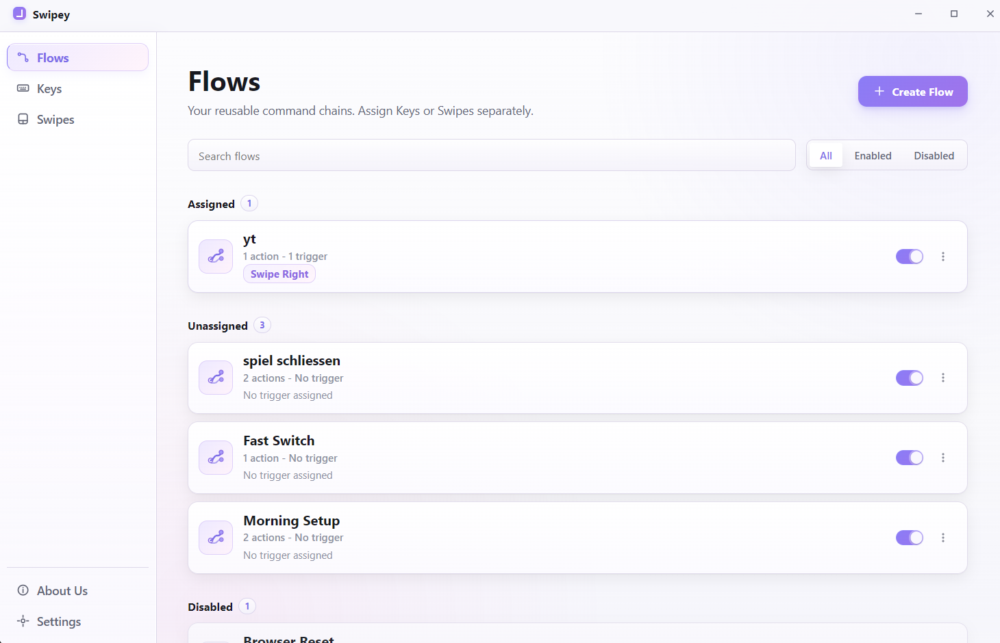
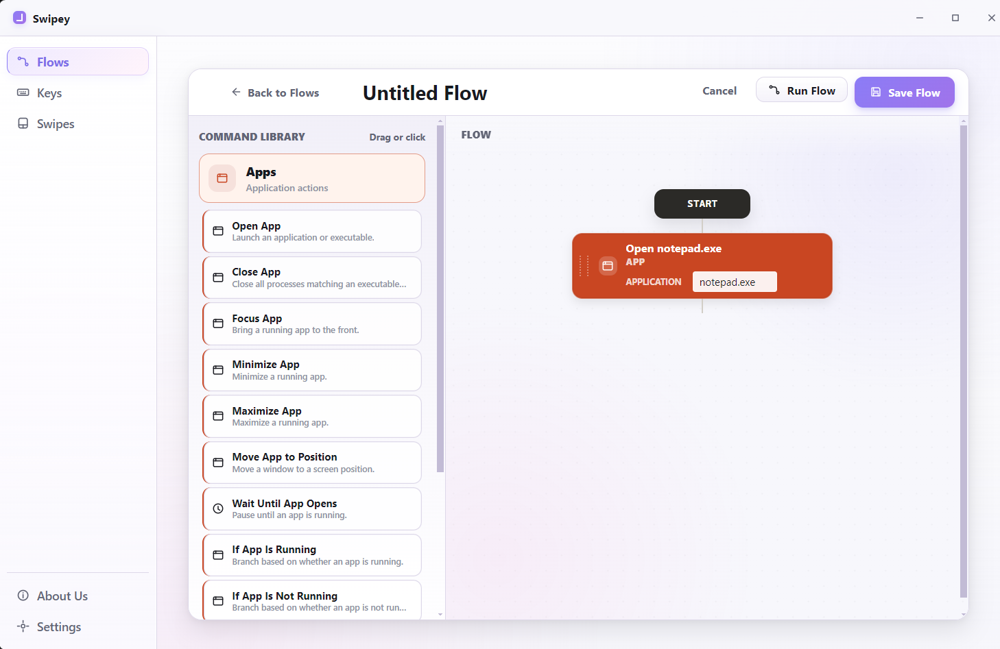
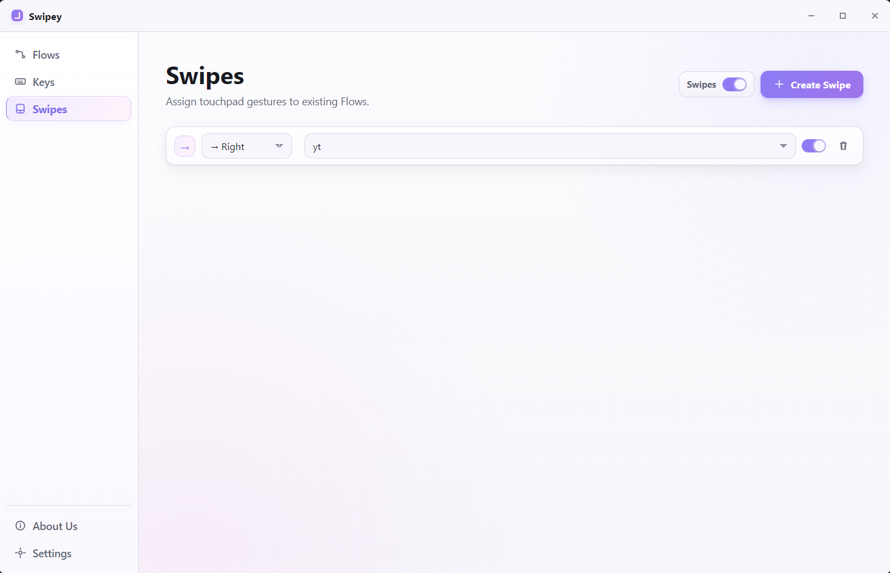

<div align="center">


# Swipey

**Build reusable Flows. Start them with a key or a touchpad swipe.**

[](https://github.com/Mago51/Swipey/releases/latest)
[](LICENSE)
[](#getting-started)
[](https://www.electronjs.org/)

[**Download for Windows**](https://github.com/Mago51/Swipey/releases/latest) · [Report an issue](https://github.com/Mago51/Swipey/issues)

</div>

<br>

## What is Swipey?

Swipey is a free, open-source Windows app for automating the things you do over and over. You build a **Flow**, which is just a chain of actions like "open VS Code, wait a second, open Chrome, focus VS Code". Then you decide how to start it: a keyboard shortcut, a two-finger swipe on your touchpad, or just a click.

The idea behind it is simple: **Trigger → Flow**. A Flow doesn't know anything about how it gets started, so the same Flow can sit behind a key and a swipe at the same time, and you never have to copy it.

I built it because I wanted my touchpad to be useful for more than moving a cursor. It's still a young project, so expect some rough edges.

## Screenshots

### Flows

All your Flows in one place, grouped into assigned, unassigned and disabled.



### Flow Editor

Drag actions from the Command Library into the canvas, or just click them.



### Swipes

Assign a touchpad swipe to any existing Flow.



## Features

| | |
|---|---|
| **Flows** | Create, edit, duplicate and delete Flows. Each one can be switched on or off with its own toggle. |
| **Flow Editor** | Visual editor with a Command Library and a canvas. Unsaved changes are tracked, so nothing gets lost by accident. |
| **Templates** | Start from a built-in template instead of an empty Flow. |
| **Actions** | Apps (open, close, focus, minimize, maximize, move), Web (open sites, search, pick a browser), Events (wait, run another Flow, variables) and PC (lock, volume, media keys). |
| **Flow logic** | Repeat, If / Else, Random Choice and Try / On Error blocks, plus variables you can use in action fields with `{{name}}`. |
| **Keys** | Record a key or key combination and assign it to a Flow. |
| **Swipes** | Two-finger swipes in four directions, assigned to Flows. |
| **Run and stop** | Run a Flow by hand from the editor, and stop it again. |
| **Tray** | Closing the window keeps Swipey running in the tray, so your triggers keep working. |
| **Emergency hotkey** | `Ctrl+Alt+Shift+S` pauses touchpad gesture recognition. |

The full action list is in [docs/flow-actions.md](docs/flow-actions.md).

## How it works

```
Trigger  ──►  Flow  ──►  Actions
```

- A **Flow** is a reusable chain of actions. It can exist without any trigger.
- A **Trigger** (a key or a swipe) starts a Flow. One Flow can have several triggers.
- Disabled Flows are never executed, no matter how they are triggered.

Swipes only react while Swipe mode is on. In that mode Swipey switches off the Windows two-finger scrolling and pinch-to-zoom settings so they don't get in the way. Your original values are saved first and restored when you turn Swipe mode off or quit the app.

## Technology stack

- [Electron](https://www.electronjs.org/) 31 for the app and UI (plain JavaScript, HTML and CSS)
- C# helpers (.NET 8, self-contained, so the installed app doesn't need .NET) for touchpad input through Raw Input, numpad key input, Windows touchpad settings and window automation
- [electron-builder](https://www.electron.build/) with NSIS for the Windows installer

## Getting started

### Install

1. Download `Swipey-Setup-1.0.0.exe` from the [latest release](https://github.com/Mago51/Swipey/releases/latest).
2. Run it. It installs for the current user and doesn't need administrator rights.

The installer is not signed, so Windows SmartScreen may show a warning.

### Run from source

You need Windows, Node.js with npm, and the .NET SDK (8 or newer).

```bash
git clone https://github.com/Mago51/Swipey.git
cd Swipey
npm install
npm run build:native
npm start
```

### Commands

| Command | What it does |
|---|---|
| `npm start` | Start the app (clears `ELECTRON_RUN_AS_NODE` first) |
| `npm run build:native` | Build the C# helpers |
| `npm run check` | Syntax check of all JavaScript files |
| `npm test` | Run all test suites |
| `npm run dist:win` | Build the Windows installer into `release/` |

## Project structure

```
main.js            Electron main process
preload.js         Bridge between main process and UI
index.html         App shell
Styles/            CSS with central design tokens
assets/            Icons and README screenshots
src/app/           UI logic
src/commands/      Action catalog and Flow templates
src/main/          Flow storage, execution, keys, swipes, touchpad
src/triggers/      Key and swipe trigger definitions
native/            C# helpers
scripts/           Build script and tests
docs/              Flow documentation
```

## Security and architecture

- The window runs with context isolation and the sandbox enabled, with Node integration off.
- A Content Security Policy is set, and navigation and popups are blocked.
- The renderer can only start saved Flows. It can't run single actions directly.
- Flow data is saved with atomic writes. A file Swipey can't read is moved aside instead of overwritten.
- Execution has guards against runaway Flows: a Flow can't run twice at once or start itself, and the number of executed steps is limited.
- Only one instance runs at a time.

## Current status

Swipey 1.0.0 is the first public release. Flows, Keys and Swipes are implemented, but Swipes have not been verified on a range of touchpad hardware (see below). The project is young.

### Known limitations

- The installer is unsigned and may trigger Windows SmartScreen.
- Touchpad hardware compatibility has not been independently verified.
- Windows 10 and clean virtual-machine compatibility have not been verified.

## Contributing

Bug reports and pull requests are welcome. Setup, tests and guidelines are in [CONTRIBUTING.md](CONTRIBUTING.md).

## License

Swipey is free software under the [GNU GPL-3.0-only](LICENSE). There are no paid tiers and no locked features.

<br>

<div align="center">

Made by [Mago51](https://github.com/Mago51)

</div>
